# PID Control: Teaching Machines to Correct Themselves

**Intern Assignment — Modern Monk Labs**

---

## 1. The Basic Idea

Imagine you are standing one metre away from a wall, and someone asks you to walk until you are exactly touching it. Now imagine doing it blindfolded. You start walking. Someone tells you: "30 centimetres away." You slow down. "10 centimetres." You slow down more. "Touching the wall." You stop.

That voice is your *sensor*. The wall is your *setpoint*. The gap between where you are and where you want to be is the *error*. And the decision about how fast to walk is your *controller*.

This is feedback control: a controller watches the error, decides what action to take, applies it to the system, and checks the result. The process repeats in a loop, thousands of times per second.

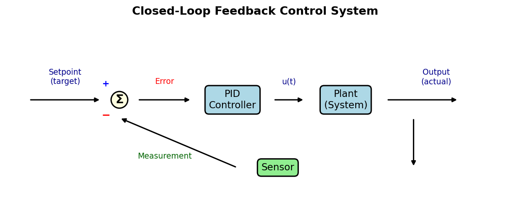{ width=85% }

The setpoint enters the loop. The controller computes a signal based on the error (setpoint minus measured output). This signal drives the plant — the physical system being controlled. A sensor measures the output and feeds it back, closing the loop.

A PID controller is the most widely used controller in engineering. The letters stand for **P**roportional, **I**ntegral, and **D**erivative — three ways of looking at the error and deciding how hard to push.

## 2. The PID Formula

**Proportional (P)** — reacts to *how large* the error is right now. **Integral (I)** — reacts to *how long* the error has been accumulating. **Derivative (D)** — reacts to *how fast* the error is changing.

$$u(t) = K_p \, e(t) \;+\; K_i \int_0^t e(\tau)\,d\tau \;+\; K_d \, \frac{de(t)}{dt}$$

where $u(t)$ is the control output (force in Newtons), $e(t) = r(t) - y(t)$ is the error, and $K_p$, $K_i$, $K_d$ are the gains controlling how aggressively each term reacts.

In plain language: P pushes proportionally to the gap. I pushes harder the longer you have been off-target. D acts like a brake — if you are approaching quickly, it eases off to prevent overshooting.

### The computer version

A computer works in discrete time steps of duration $\Delta t$. At each step $n$:

$$u[n] = K_p \, e[n] \;+\; K_i \sum_{j=0}^{n} e[j] \cdot \Delta t \;+\; K_d \, \frac{e[n] - e[n-1]}{\Delta t}$$

The integral becomes a running sum, the derivative becomes a finite difference.

## 3. The Test System

Our test system is a 1 kg block on a spring with a damper — like a car suspension. Mass $m = 1$ kg, damping $c = 10$ N·s/m, spring constant $k = 20$ N/m. The goal is to move it to 1 m.

$$m\ddot{x} + c\dot{x} + kx = u(t)$$

The spring pulls back with force $kx$, the damper resists with $c\dot{x}$, and our controller pushes with $u(t)$.

**Why P alone always stops short.** At steady state ($\ddot{x} = 0$, $\dot{x} = 0$): $kx_{ss} = u_{ss}$. With a P-only controller, $u = K_p(1 - x)$, so $K_p(1 - x_{ss}) = kx_{ss}$, giving:

$$x_{ss} = \frac{K_p}{K_p + k}, \qquad e_{ss} = \frac{k}{K_p + k}$$

With $k = 20$, $K_p = 100$: the block stops at 0.833 m, leaving 0.167 m error. No matter how large $K_p$ is, some error remains — the spring always needs force to stay compressed. This is why the integral term exists.

## 4. How to Judge a Result

Four metrics characterize a step response:

1. **Rise time ($t_r$)**: Time from when the output first crosses 10% of the setpoint to when it first crosses 90%. Note: with P-only control, the response can temporarily pass through 90% during the transient before falling back to a lower steady-state value. In such cases the rise time still describes how quickly the initial approach happens, even though the block does not stay at 90%.
2. **Overshoot**: How far past the *setpoint* the output goes: $\frac{y_{peak} - y_{target}}{y_{target}} \times 100\%$. A response that peaks below the setpoint has 0% overshoot.
3. **Settling time ($t_s$)**: Time after which the output stays permanently within ±2% of the setpoint. A P-only controller with significant steady-state error may *never* settle within this band — the settling time is then undefined, which we mark as "—" in the tables.
4. **Steady-state error ($e_{ss}$)**: The gap between the setpoint and the average final value.

To show all four metrics clearly on one graph, we use a PID controller (Kp=200, Ki=80, Kd=2) that produces visible overshoot and then settles. This is a different configuration from the P-only experiments in Section 5 — it is chosen specifically because it makes every metric visible.

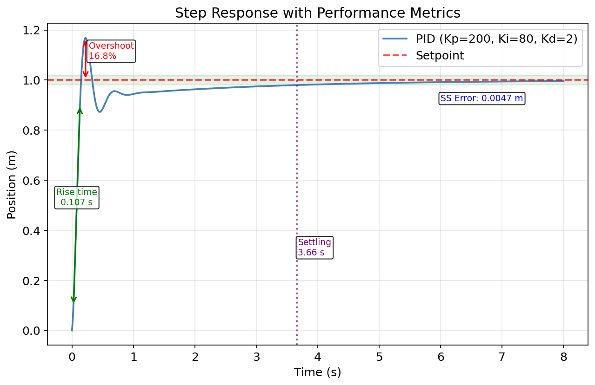{ width=80% }

*PID response (Kp=200, Ki=80, Kd=2): rise time 0.107 s, overshoot 16.8%, settling 3.66 s, SS error 0.005 m.*

A good controller minimises all four, but there are trade-offs: faster rise usually means more overshoot.

## 5. Each Part Alone

### Proportional control

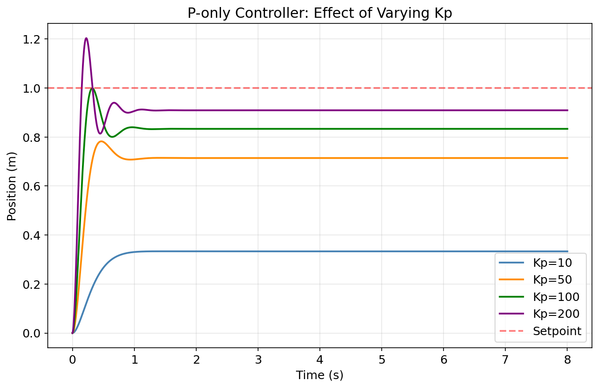{ width=80% }

| Kp  | Rise Time (s) | Overshoot (%) | SS Error (sim) | SS Error (theory) |
|-----|---------------|---------------|----------------|-------------------|
| 10  | —             | 0.0           | 0.667          | 0.667             |
| 50  | —             | 0.0           | 0.286          | 0.286             |
| 100 | 0.184†        | 0.0           | 0.167          | 0.167             |
| 200 | 0.102         | 20.3          | 0.091          | 0.091             |

Simulated errors match $e_{ss} = k/(K_p + k)$ exactly, confirming both model and code. Increasing $K_p$ reduces error but never eliminates it, and too-high $K_p$ causes overshoot.

**†** A note on Kp=100: the response temporarily passes through 0.9 m during its initial rise (peak of 0.999 m), then settles back to 0.833 m. So rise time is measured during the transient. The 0% overshoot is correct — the peak (0.999 m) is below the 1.0 m *setpoint*. And the settling time is "—" because the final value of 0.833 m is far outside the ±2% band around the setpoint.

### Adding the integral term

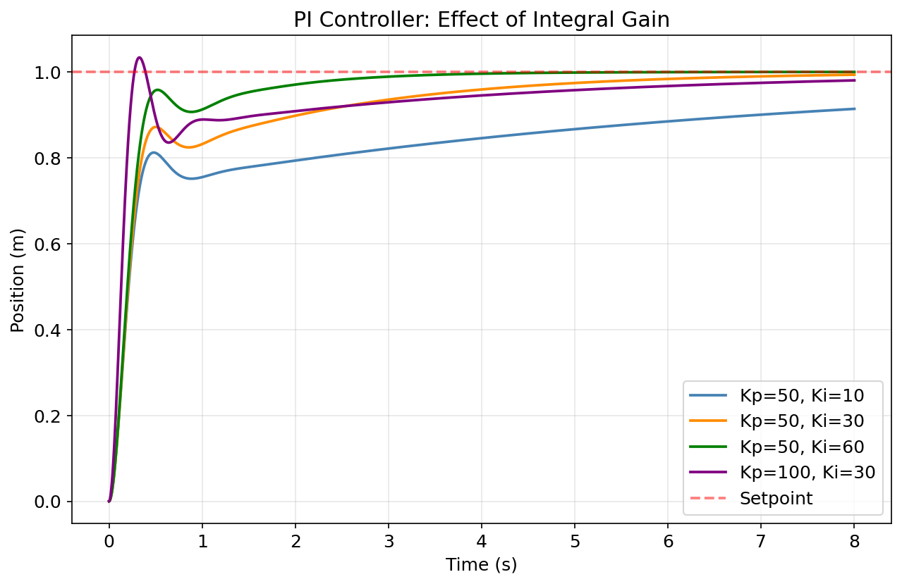{ width=80% }

| Kp  | Ki | Rise Time (s) | Overshoot (%) | SS Error (m) |
|-----|-----|---------------|---------------|--------------|
| 50  | 10  | 6.90          | 0.0           | 0.091        |
| 50  | 30  | 1.97          | 0.0           | 0.008        |
| 50  | 60  | 0.32          | 0.0           | 0.000        |
| 100 | 30  | 0.18          | 3.4           | 0.022        |

With Ki=60, the block reaches exactly 1.000 m. The integral accumulates past error until it generates enough force to overcome the spring — something P cannot do alone.

### Adding the derivative term

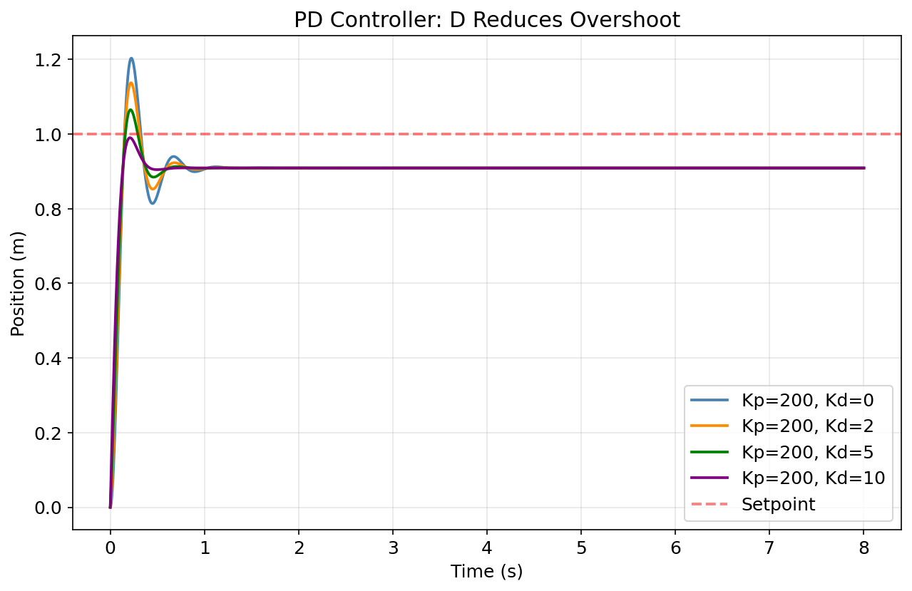{ width=80% }

| Kp  | Kd | Overshoot (%) | SS Error (m) |
|-----|-----|---------------|--------------|
| 200 | 0   | 20.3          | 0.091        |
| 200 | 2   | 13.7          | 0.091        |
| 200 | 5   | 6.5           | 0.091        |
| 200 | 10  | 0.0           | 0.091        |

Overshoot drops from 20.3% to zero — D brakes the approach. But SS error stays at 0.091 m: D does nothing about a constant offset. D reduces bouncing; only I eliminates the final gap.

## 6. All Together

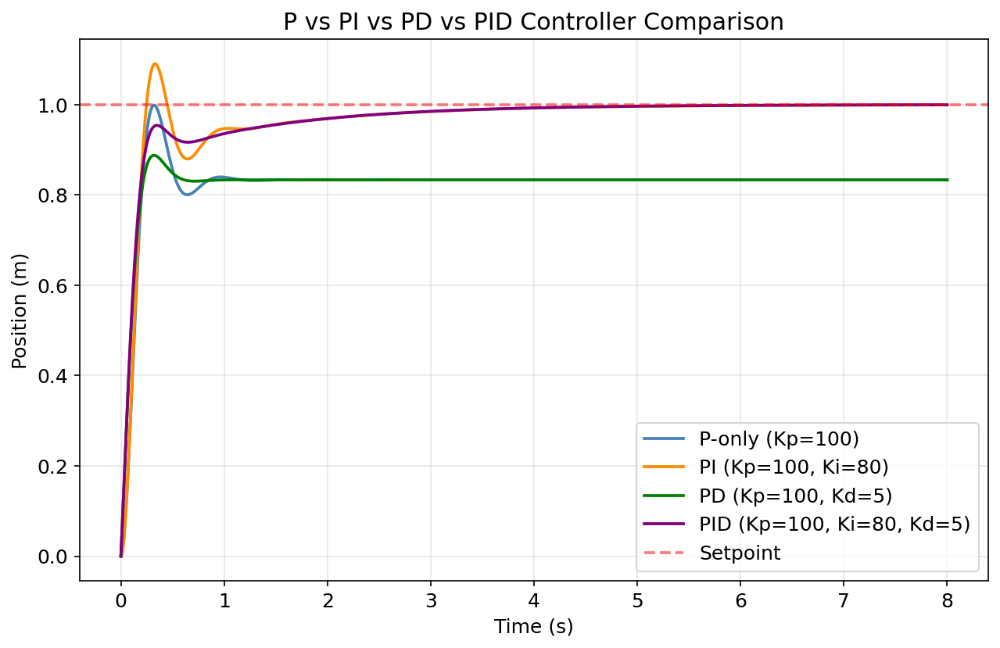{ width=85% }

| Controller             | Rise (s) | Overshoot (%) | Settling (s) | SS Error (m) |
|------------------------|----------|---------------|--------------|--------------|
| P (Kp=100)             | 0.184†   | 0.0           | —*           | 0.167        |
| PI (Kp=100, Ki=80)     | 0.166    | 9.1           | 2.60         | 0.001        |
| PD (Kp=100, Kd=5)      | —        | 0.0           | —*           | 0.167        |
| PID (Kp=100, Ki=80, Kd=5) | 0.220 | 0.0           | 2.59         | 0.001        |

*(\*) Never settles within ±2% of setpoint due to persistent steady-state error (0.167 m >> 0.02 m band). † Transient crossing; see Section 5 note.*

PID captures both strengths: **I** eliminates SS error; **D** removes the 9.1% overshoot PI introduces. **Chosen gains: Kp=100, Ki=80, Kd=5** — fast response (0.22 s rise), zero overshoot, negligible SS error.

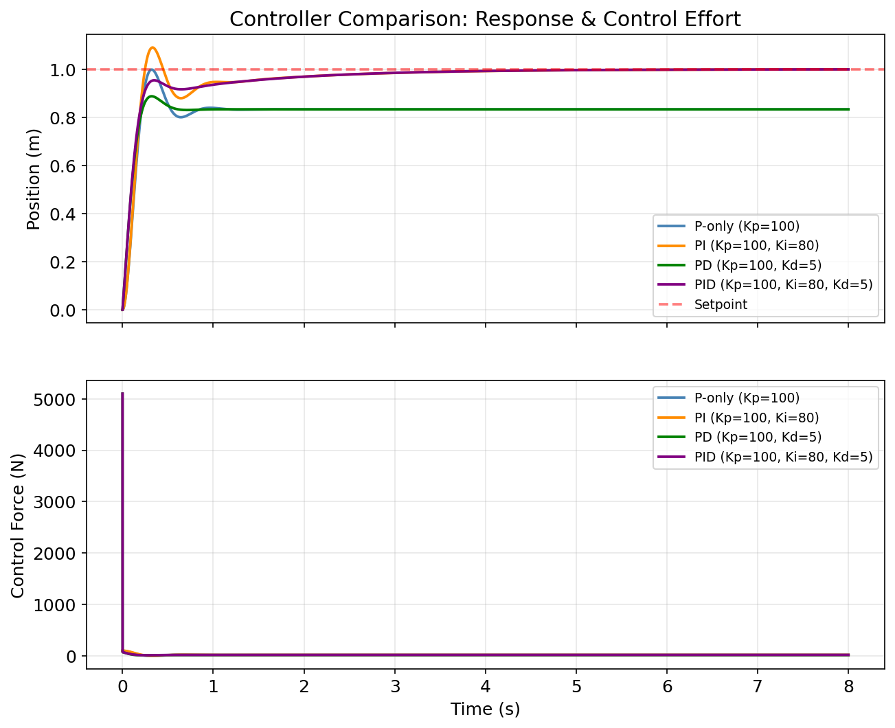{ width=85% }

## 7. Real-World Problems

### (a) Integral windup

When force is capped at ±30 N, the integral keeps accumulating during saturation, causing overshoot when the system finally reaches target.

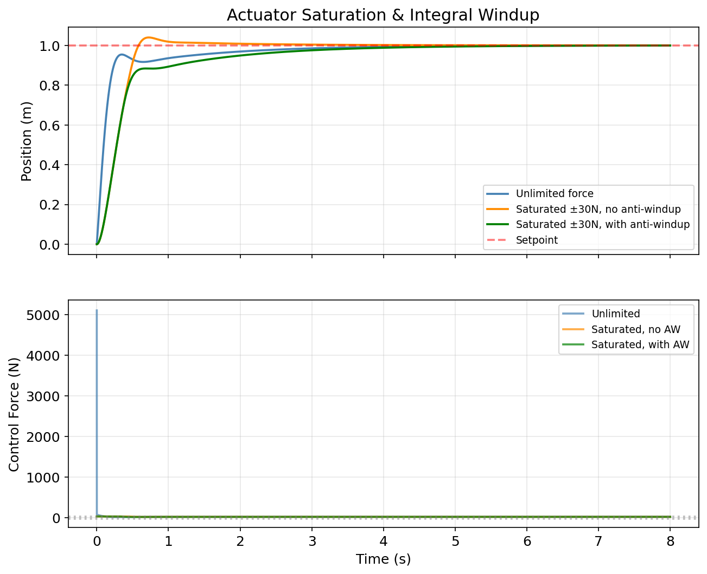{ width=85% }

| Configuration         | Overshoot (%) | Settling (s) |
|-----------------------|---------------|--------------|
| Unlimited force       | 0.0           | 2.59         |
| Saturated, no AW      | 4.0           | 0.97         |
| Saturated, with AW    | 0.0           | 3.28         |

**Fix:** When output is clipped, stop accumulating the integral (*anti-windup by clamping*).

### (b) Noisy sensor

A ±1 mm sensor noise looks like 1 m/s velocity to the D term over a 1 ms timestep, creating huge control spikes.

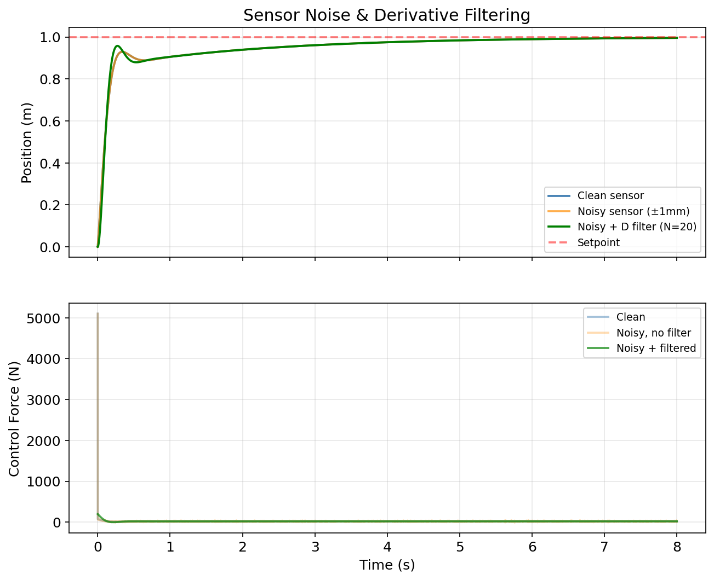{ width=85% }

**Fix:** A first-order low-pass filter on the derivative: $D_{f}[n] = \alpha \cdot D_{raw}[n] + (1 - \alpha) \cdot D_{f}[n-1]$, where $\alpha = \frac{N \Delta t}{1 + N \Delta t}$. With N=20 (filter bandwidth), the control signal is smoothed dramatically while the position response remains nearly identical to the noise-free case — the filter removes the noise without significantly delaying the damping action.

### (c) Derivative kick

A step change in setpoint makes the error jump instantaneously — derivative is theoretically infinite.

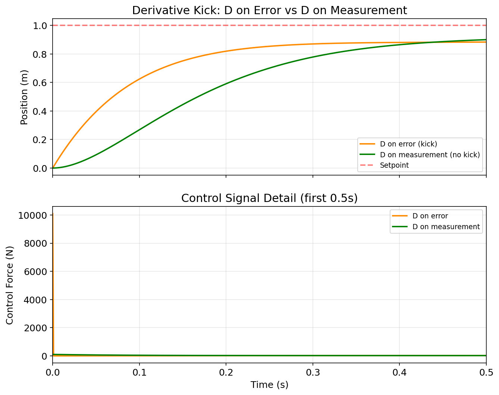{ width=85% }

**Fix:** Compute derivative of *measurement* instead of error: $-K_d \frac{dy}{dt}$. The physical position cannot jump, so the derivative stays smooth.

### (d) Update rate

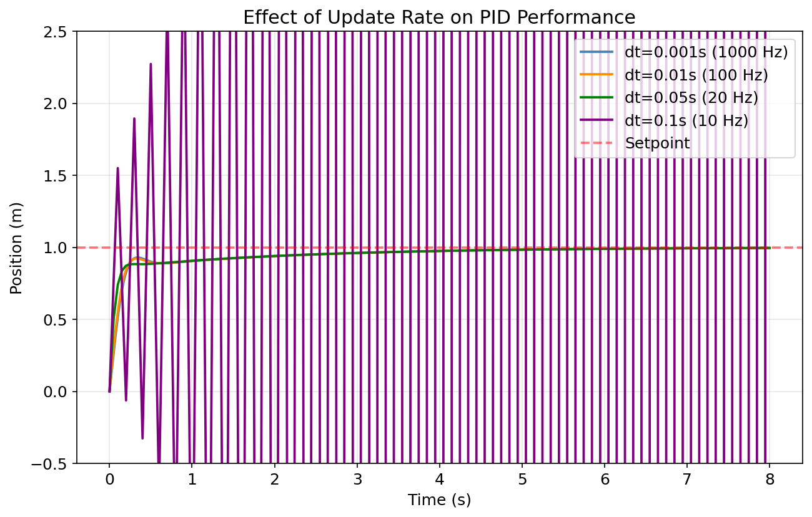{ width=80% }

| Rate    | dt     | Overshoot | Stable? |
|---------|--------|-----------|---------|
| 1000 Hz | 0.001s | 0.0%      | Yes     |
| 100 Hz  | 0.01s  | 0.0%      | Yes     |
| 20 Hz   | 0.05s  | 0.0%      | Yes     |
| 10 Hz   | 0.1s   | Unstable  | No      |

The instability at 10 Hz is not because 10 Hz is always too slow for any controller — it is because our specific combination of gains (Kp=100, Ki=80, Kd=5) and integration method (Euler) becomes numerically unstable at this large step size. The gains were tuned for dt=0.001s; at dt=0.1s, the effective loop gain exceeds the stability limit. With lower gains or a better integration scheme (e.g. Runge-Kutta), 10 Hz could work for this plant.

As a practical rule: sample at least 10× faster than the system's fastest dynamics, and retune the gains if you must run slower.

## 8. Choosing the Gains

### Manual tuning

1. Set Ki=Kd=0. Increase Kp until it responds quickly but oscillates.
2. Add Kd to calm oscillations.
3. Increase Ki slowly to kill SS error.
4. Fine-tune all three.

### Ziegler-Nichols method

Applied to $G(s) = \frac{1}{(s+1)^3}$. Increase P-only gain until sustained oscillation.

**Theory:** Phase = $-3\arctan(\omega) = -180°$ at $\omega = \sqrt{3}$. Magnitude = $1/8$. So $K_u = 8$, $T_u = 2\pi/\sqrt{3} \approx 3.63$ s.

**Simulation verification:** We swept Kp from 2 to 8.5 and compared oscillation amplitude in the first and second halves of a 60-second simulation to classify each response:

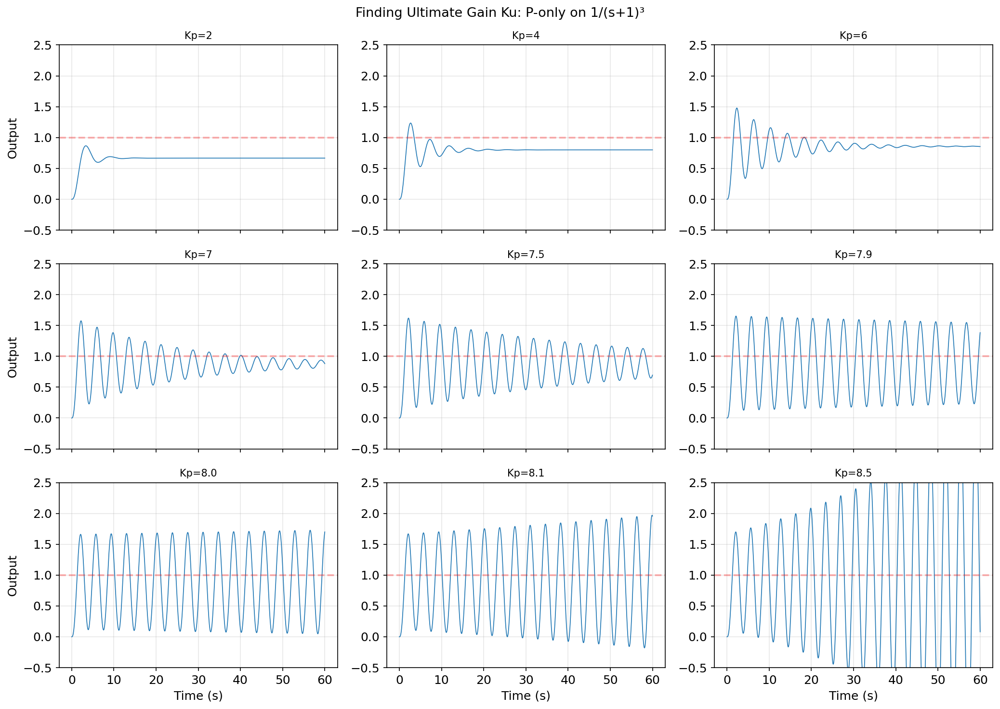{ width=90% }

*At Kp < 8 the oscillations slowly decay; at Kp $\approx$ 8 the amplitude barely changes between early and late windows (marginal stability); at Kp > 8 the oscillations grow. This confirms the theoretical $K_u = 8$. Gains below 8 (e.g., Kp=6 or 7) show slowly decaying oscillation, not truly sustained — the decay is slow because these gains are close to the stability boundary but still below it.*

**ZN recipe:** PID gains: $K_p = 0.6 K_u = 4.80$, $K_i = K_p/(T_u/2) = 2.65$, $K_d = K_p \cdot T_u/8 = 2.18$.

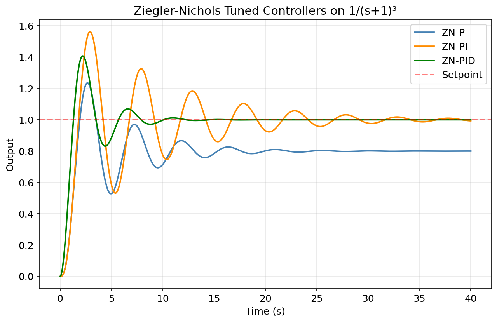{ width=80% }

| Controller | Rise (s) | Overshoot (%) | Settling (s) | SS Error |
|------------|----------|---------------|--------------|----------|
| ZN-P       | 1.15     | 23.5          | —            | 0.200    |
| ZN-PI      | 1.05     | 56.2          | 30.8         | 0.002    |
| ZN-PID     | 0.87     | 40.7          | 9.37         | 0.000    |

**Improving ZN-PID:** Reduce Ki, increase Kd, slightly reduce Kp.

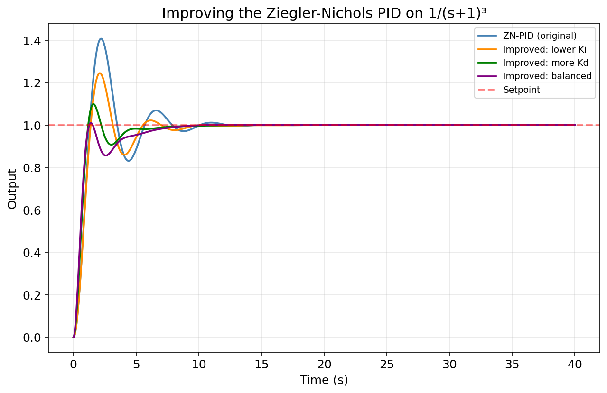{ width=80% }

| Variant              | Kp   | Ki   | Kd   | Overshoot (%) | Settling (s) |
|----------------------|------|------|------|---------------|--------------|
| ZN original          | 4.80 | 2.65 | 2.18 | 40.7          | 9.37         |
| Lower Ki             | 4.80 | 1.32 | 2.18 | 24.5          | 8.54         |
| Lower Ki + more Kd   | 4.80 | 1.32 | 4.35 | 9.9           | 4.54         |
| Balanced             | 3.84 | 1.06 | 5.44 | 1.0           | 6.74         |

Overshoot drops from 40.7% to 1.0%. ZN is a starting point, not a final answer.

## 9. The Code

The PID controller (`src/pid_controller.py`) includes all fixes from Section 7: saturation, anti-windup, derivative filtering, and derivative-on-measurement. The plant models (`src/plant_models.py`) implement the mass-spring-damper and third-order system using semi-implicit Euler integration.

```python
# Core PID computation (simplified)
error = setpoint - measurement
P = Kp * error
self.integral += error * dt
I = Ki * self.integral
D = Kd * (error - self.prev_error) / dt
u = clamp(P + I + D, u_min, u_max)
if anti_windup and saturated:
    self.integral -= error * dt
```

To reproduce all figures: `pip install -r requirements.txt && python src/run_all.py`

## 10. Real Robots and Common Myths

### Real-world applications

**DC motor speed control.** An encoder measures RPM, PID adjusts voltage. D is critical for responding to sudden load changes.

**Drone altitude hold.** Barometer/accelerometer feed a PID that adjusts thrust. I compensates for battery drain and wind; D prevents bobbing.

**Robot arm positioning.** Each joint has its own PID. The challenge: load varies with arm configuration, so the same joint supports different weights at different angles.

**Line-following robot.** IR sensors measure drift from line. P-only causes wild oscillation; D dampens it, I corrects systematic drift.

**Cruise control.** PID adjusts throttle to maintain speed. I handles uphills; D prevents runaway acceleration downhill.

### Common myths

**"PID can control anything."** PID works for SISO, roughly linear systems. Significant delays, strong nonlinearities, or coupled multi-variable systems need more advanced approaches.

**"More gain is always better."** High gains amplify noise and can excite mechanical resonances. As section 5 showed, Kp=200 gives 20% overshoot.

**"Derivative on error is fine."** Section 7(c) showed the setpoint kick problem. Derivative on measurement is usually preferred in practice.

**"Once tuned, PID never needs retuning."** Gains tuned for one operating point may fail at another — a drone at 10 m altitude behaves differently at 100 m. Gain scheduling is common in critical applications.

**"Ziegler-Nichols gives optimal gains."** ZN gave 40.7% overshoot in our test. It is a systematic starting point from 1942, not a modern optimum.

---

**AI-Use Disclosure.** This assignment was completed with assistance from an AI tool for learning the concepts and research the whole field in a faster manner and debugging the errors.
